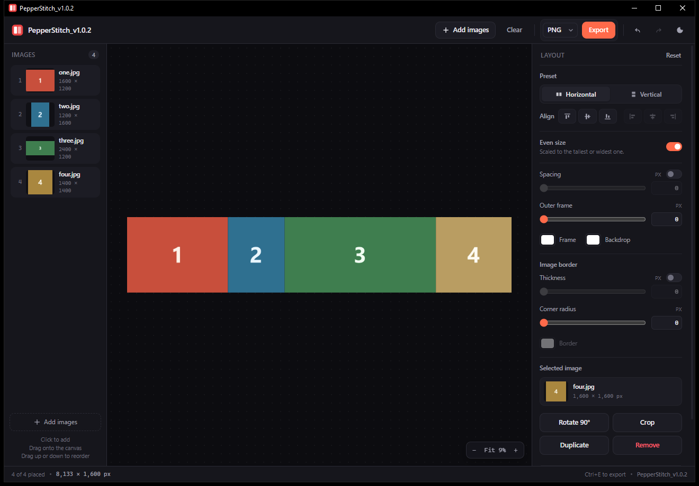

# PepperStitch

**PepperStitch is a Windows app that stitches photos into one wide or tall
image** — a strip, a stack, or a free collage of your own. Pictures land in a
library on the left; drag them onto the canvas, arrange them, and export the
result at the originals' full resolution. One self-contained executable: no
installer, no browser window, no cloud, no account.



- **Platform:** Windows 10 or 11, 64-bit. The only external piece is the
  [Microsoft Edge WebView2 Runtime](https://developer.microsoft.com/microsoft-edge/webview2/),
  which ships with both.
- **Single file:** about 800 kB, runs from any folder, writes only to
  `%LOCALAPPDATA%\PepperStitch`.
- **Exports:** PNG, JPEG and WebP at full resolution, with transparent gaps in
  PNG and WebP.
- **Licence:** Apache 2.0 — free for personal or commercial use.

It is a quick way to join a before-and-after pair, a step-by-step sequence, a
strip of screenshots or a comic-style storyboard, without opening a full image
editor.

## What it does

- **A library and a canvas.** Every picture you open joins the library. Click
  one to add it beside the last, or drag it onto the canvas to place it where
  you drop it. A picture can be placed any number of times, so duplicating is
  just dragging it again. Drag a thumbnail up or down and the list reorders
  itself, which changes nothing on the canvas. The × on a thumbnail drops that
  picture from the library, along with every copy of it on the canvas.
- **Arrange, then free.** The two presets are actions: Horizontal and Vertical
  pack the pictures once, in the order they stand in the library — so putting the
  list in a different order and pressing a preset re-packs the row or column to
  match. After that every picture is free — drag it anywhere, or nudge it with
  the arrow keys, a pixel at a time (ten with <kbd>Shift</kbd>). A drag snaps to
  a neighbour's edges and centres, so pictures meet at the spacing you asked
  for; hold <kbd>Shift</kbd> while dragging and it goes exactly where the
  pointer is instead.
- **Line the pictures up.** Six buttons under the preset tidy the whole
  composition along one axis, and the preset picks the three that apply: a row
  is lined up by its tops, middles or bottoms, a column by its lefts, centres or
  rights. Every picture moves to the outermost edge, or to the middle of that
  span, with every size left alone — the other axis keeps the arrangement you
  gave it.
- **Undo and redo.** <kbd>Ctrl</kbd>+<kbd>Z</kbd> steps back through the last
  sixty changes — a drag, a resize, a crop, a preset, an alignment, even a
  picture leaving the list — and <kbd>Ctrl</kbd>+<kbd>Shift</kbd>+<kbd>Z</kbd>
  or <kbd>Ctrl</kbd>+<kbd>Y</kbd> steps forward again. The two arrows beside the
  theme button do the same.
- **Resize one picture with the wheel.** Point at a picture and scroll: it grows
  or shrinks about its own centre, in steps of about 5%, and the rest of the
  composition stays where you put it. This switches Even size off, since the
  pictures no longer share an edge; turning it back on makes them even again.
  <kbd>Ctrl</kbd>+wheel still zooms the preview.
- **Resize with the handles.** The selected picture carries eight handles. Drag
  one and it grows or shrinks about the corner or edge opposite, keeping its own
  proportions; the edge you are pulling snaps to the other pictures, so a
  resized picture can be made to meet its neighbour exactly. Hold
  <kbd>Shift</kbd> while pulling a handle and the snap steps aside.
- **Crop a picture.** Select one and press **Crop** (or <kbd>C</kbd>), drag a
  frame over the part to keep, then press <kbd>Enter</kbd> — the picture takes
  the crop's shape and keeps its place on the canvas. Pull the handles to adjust
  it, drag inside to move it, and <kbd>Esc</kbd> drops it. Crop again to narrow
  what is already kept.
- **Crop to a shape.** Type a ratio — `16:9`, `4:5`, `1:1`, or a single number
  such as `1.5` — into the field on the crop bar and the frame takes that shape;
  the × beside it frees the frame again. Any of `: / * - + '` works between the
  sides, and a dot mostly does too (`16.9` is 16 by 9, while `1.5` and `2.39`
  stay numbers). Holding <kbd>Shift</kbd> while dragging is the quick 1:1. An
  empty field means free-form.
- **Even size.** On, the pictures share one edge: the height in a row, the width
  in a column. Off, every picture keeps its own pixel size.
- **A bare canvas.** Nothing is painted behind the pictures: gaps between them
  stay transparent, so a PNG or WebP drops onto any background. JPEG, which has
  no alpha, is flattened onto the backdrop colour instead.
- **Frames and spacing.** An outer frame colour, a gap between pictures, and a
  per-picture border with its own colour and corner radius — each with a switch
  to turn it off without losing the value. Changing a gap or a border never
  moves the pictures already placed: the new gap applies to the next picture you
  place and to snapping, and a thicker border grows the canvas around them,
  sliding the whole composition inward with it so no border is cut off. Two
  neighbours share one border band instead of stacking two, so with no gap the
  border between them is as thick as the border around the outside; a gap widens
  that band. The outer frame never moves anything.
- **Right-click a picture on the canvas** to rotate it, flip it or remove it.
- **Export at full resolution.** The preview is a downscaled stand-in; the
  exported file is built from the original pictures, one at a time.

Pictures arrive by drop, by **Add images** / <kbd>Ctrl</kbd>+<kbd>O</kbd>, by
paste (<kbd>Ctrl</kbd>+<kbd>V</kbd>), or by passing them on the command line:

```
PepperStitch_v1.0.1.exe photo1.jpg photo2.jpg photo3.jpg
```

A drop is area-aware: onto the library it only adds pictures there, onto the
canvas it adds them to the library and places them where you let go.

## Keyboard

| Keys | Action |
| --- | --- |
| <kbd>Ctrl</kbd>+<kbd>O</kbd> | Add images to the library |
| <kbd>Ctrl</kbd>+<kbd>E</kbd> | Export |
| <kbd>Ctrl</kbd>+<kbd>0</kbd> | Fit the preview to the window |
| <kbd>Ctrl</kbd>+wheel | Zoom the preview |
| wheel | Resize the picture under the pointer |
| <kbd>C</kbd> | Crop the selected picture |
| <kbd>Shift</kbd>+drag (crop) | Keep the crop frame at 1:1 |
| <kbd>Enter</kbd> / <kbd>Esc</kbd> | Keep or drop the crop frame |
| arrow | Move the selected picture by 1 px |
| <kbd>Shift</kbd>+arrow | Move it by 10 px |
| <kbd>Delete</kbd> | Remove the selected picture from the canvas |

Hold <kbd>Shift</kbd> while dragging a picture, or while pulling one of its
resize handles, and it stops snapping: it goes exactly where the pointer says.

## Requirements

- Windows 10 or 11, 64-bit.
- The [Microsoft Edge WebView2 Runtime](https://developer.microsoft.com/microsoft-edge/webview2/).
  It ships with Windows 11 and with current Windows 10 updates; if it is
  missing, PepperStitch tells you so and links to the download.

Nothing else: the executable is self-contained apart from that runtime.

## Building

You need **CMake 3.20 or newer** and either **MinGW-w64** (`g++`,
`mingw32-make` and `windres` on the `PATH`) or **Visual Studio 2022** with the
"Desktop development with C++" workload. `build.bat` finds whichever is present.

The WebView2 SDK is downloaded from NuGet on the first configure. To use an
already unpacked copy instead — useful offline — point at its `build\native`
folder:

```
build.bat --webview2 "C:\path\to\Microsoft.Web.WebView2.1.0.4258.31\build\native"
```

Other switches:

```
build.bat --same              rebuild the current version
build.bat --version 1.2.3     set the version, then build
build.bat --debug             debug build (never bumps)
build.bat --clean             delete the build tree first
```

The result is `dist\PepperStitch_v1.0.1.exe`, a single file of about 800 kB. The
version number lives in `project(PepperStitch VERSION ...)` in `CMakeLists.txt`,
and `build.bat` moves the patch on by itself when a file under `src/` or
`assets/` has changed since the last build, so a build cannot quietly carry a
number that is already published. `--same` rebuilds without bumping;
`--version` sets it outright, which is how a minor or major release is made.
That one number names the executable, fills in the version resource, and shows
up as `PepperStitch_v1.0.1` in the title bar and in the app's own header.
Exported pictures keep the plain name.

The interface is compiled into the executable as a resource, not shipped beside
it. On start-up it is unpacked into `%LOCALAPPDATA%\PepperStitch\assets`, so the
exe can be copied anywhere and run on its own.

## How it is put together

```
src/main.cpp        Win32 host: window, WebView2, resources, save dialog
src/app.rc          Icon, version info, front-end and loader resources
assets/             index.html, style.css, app.js — the whole interface
tools/make-icon.ps1 regenerates src/app.ico and docs/icon.png
tools/dev-server.ps1 serves assets/ for working in a browser
tools/bump-version.ps1 keeps the version in CMakeLists.txt in step
```

The host is a plain Win32 window with a WebView2 in it. The page is served from
the virtual host `https://app.local`, mapped to the unpacked asset folder. Three
more virtual hosts are answered by `main.cpp` in the `WebResourceRequested`
event instead of the network:

| Host | Purpose |
| --- | --- |
| `https://file.local/<n>` | pictures the host was handed (command line, drop) |
| `https://save.local/save` | shows the Save dialog and writes the exported bytes |
| `https://host.local/…` | `/ready`, `/reveal`, `/theme`, `/devtools` |

All of this happens in the page: layout, preview painting and export, on
canvases. The host never decodes an image.

**The layout in one sentence:** the canvas is the bounding box of the placed
pictures, each of which remembers its own position, size, rotation, scale and
crop; a preset is a one-off arrangement that packs them into a row or a column,
and Even size gives every picture the same height (or width) once.

Preview bitmaps are decoded at no more than 1800 px, which keeps memory flat
while dragging sliders. Export decodes each original at full resolution, draws
it, and closes it before moving to the next picture, so peak memory stays near
one picture rather than the whole stitch.

## Limits worth knowing

- **HEIC/HEIF** is not supported yet; the app says so and asks for JPEG or PNG.
- **No text or stickers.** Pictures, frames and spacing only.
- **Canvas ceiling.** A single export is capped at 65,535 px per side and
  268,435,456 px in total (Chromium's canvas limits). The status bar says when a
  layout is over, and Export is disabled rather than failing halfway.
- **Settings are remembered, pictures are not.** The preset, sizes and colours
  persist in `localStorage`; the photos are never written to disk by the preview.

## Licence

Apache License 2.0 — see [LICENSE](LICENSE). Copyright 2026 the PepperStitch
authors; the executable's version information says the same.
